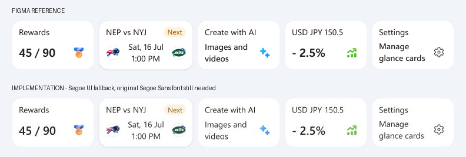

# Glance Card 验收记录

2026-10-13。来源：[Figma 5826:53496](https://www.figma.com/design/x2wnQRhqdGBZcsouyMMQUV/C4-Bing-App-%E2%80%94-MAI-Style-Alignment?node-id=5826-53496&m=dev)。

## 结论

已实现五张可见卡片与可横向浏览的卡片组，接入 Library → Composite → Glance Card 和 Consumer/Glance Card Storybook。
**未达到 100% 字体还原**：原稿是 Segoe Sans 可变字体（450 / 550 / 650，含光学字号轴）；项目的现有 @font-face 使用静态 Segoe UI regular / semibold，无法精确表达中间字重，正文偏细。已向用户询问原版字体的本地路径，尚未取得。
没有通过加粗替代值、拉伸字形或截图嵌入组件来掩盖差异。

## 后续展示调整

按用户要求，Library 的 Overview 在上方展示 Card group，下面独立展示五张卡片；Overview 沿用其他副标题的样式。
卡片组默认改为 Hug 内容宽度（五张默认卡片共 752 px），不再内置 353 px 宽度。
Prototype 按机型从外部限制组宽度；Storybook 的 `Constrained Group` 提供 353 px 容器示例。
下方 353 px 视区数据和截图保留为初次验收记录，不代表当前默认组宽度。

本次复检：Overview 组宽与内容宽均为 752 px，973 px 画布中五张卡片完整可见，单卡尺寸保持不变。
外部 353 px 容器示例中组宽为 353、内容宽为 752；End 键滚至 399 并聚焦 Settings。
生产构建、Storybook 构建和 4 项 Glance Card 交互测试通过。

## 已核对规格

| 项目 | Figma | 浏览器实测 |
| --- | --- | --- |
| 普通卡片 | 140 × 84 | 140 × 84 |
| 体育卡片 | 160 × 84 | 160 × 84 |
| 圆角 / 内描边 | 16 / 0.5 | 16 / 0.5 |
| 卡片间距 | 8 | 8 |
| 标题位置 / 行高 | (12, 10) / 20 | (12, 10) / 20 |
| 普通内容区域 | (12, 34), 116 × 42 | 一致 |
| Settings 内容区域 | (12, 34), 116 × 40 | 一致 |
| 数值位置 / 行高 | (12, 42) / 26 | 一致 |
| 普通图标槽 | (104, 45), 20 × 20 | 一致 |
| Settings 图标槽 | (104, 44), 20 × 20 | 一致 |
| 球队图标槽 | (12, 43), (124, 43), 24 × 24 | 一致 |
| 卡片组视区 / 全部内容宽度 | 353 / 752 | 353 / 752 |

截图包含体育卡片阴影，所以整体图像为 752 × 88。组件滚动区域同样保留 1 px 上方、3 px 下方阴影空间；负外边距保持布局占高为 84。
Money 的 SVG 保留原始根尺寸 15.6307 × 15.6133，并居中在 20 × 20 图标槽内；未将 SVG 拉满槽位。

## 资源

- 6 个 Figma 原始文件均保存在 `src/components/GlanceCard/assets/`，无临时 Figma URL。
- Rewards / Create / Money 使用原始 SVG；Sports 保留两组各两层 PNG；Settings 使用已安装 `@fluentui/react-icons` 的 `Settings20Regular`。
- 浏览器逐项检查 8 个可见图像 / SVG 实例：全部加载成功，槽位与有效尺寸正确。
- `geometry.json` 保存实测结果，`asset-manifest.json` 保存本地文件大小与 SHA-256。
- Figma 节点中隐藏的旧体育卡片未实现为额外可见变体。

## 交互和主题

- 393 × 852 视口中，卡片组宽 353，内容宽 752；页面宽与滚动宽均为 393，没有页面级横向溢出。
- 原生横向滚动实测从 0 移至 316；End 键滚到 399 并聚焦 Settings；Enter 激活后回调输出 `Selected: settings`。
- 单元测试检查数据覆盖、disabled 阻止回调、跳过禁用卡片的方向键/Home/End 导航，以及子项取消组回调。
- 深色模式实测卡面 `#282d3e`、文字 `#e5ebfa`，尺寸保持一致。深色是项目既有主题的适配，不是由该浅色 Figma 节点推导出的独立精确稿。
- 工作台 Library 入口正常，Styles 仍为空。浏览器没有报错。

## 对照截图

自动检查：38 项测试通过；生产构建与 Storybook 构建通过；token 合约检查和 `git diff --check` 通过。

上：Figma；下：实际实现。浏览器工具输出有损 JPEG，截图比较用于视觉检查，不作为像素完全相等的证明。

其他截图：`workbench.jpg`、`mobile-interaction.jpg`、`dark.jpg`。

## 预览

- 工作台：http://127.0.0.1:5174/
- Storybook：http://127.0.0.1:6007/?path=/story/consumer-glance-card--group

取得原版 Segoe Sans 后，需重新检查 450/550/650 字重、文字基线和字宽，并更新对照图后才能认定精确还原。
