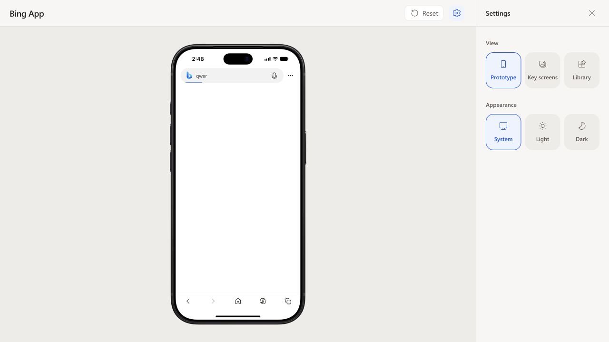

# IAB search loading progress

Updated 2026-10-22 from the user's Bing iOS loading screenshot.

- Replaces the central Searching Bing message with a 2 px blue line inside the
  bottom edge of the shared AppSearchBox. Capsule clipping follows its radius.
- Current 402 × 874 device: search capsule remains 332 × 48; no spacing changes.
- Request, valid HTML, iframe completion, failure and Retry drive progress.
  Motion is an estimate of loading stages; only the actual iframe load event
  completes it. See [sources and tuning](../../motion.md#iab-search-loading).
- Library → Inputs → Bing Search Box → Search results has a passive Loading
  specimen and a Loaded state in the existing side control.

Validation:

- `npm test -- src/screens/SERP src/components/AppSearchBox src/components/PreviewWorkbench/PreviewWorkbench.test.tsx`: 26 tests passed across 5 files.
- `npm run build`: passed (existing bundle-size warning).
- Tests cover pending request vs document loading, completion, failure/retry,
  new query cancellation, stale response handling and request timeout.
- Browser: real Weather and qwer queries display the line in the composer;
  both load Bing HTML and the line disappears. Measured composer
  332 × 48 and line height 2 px. No central loading message remains.
- Library Loading stays at scaleX 0.36 inside inert artwork, with a 358 × 48
  specimen. Dark appearance uses the blue `#82aefa` line at the same 2 px height.
  Restored System appearance after checking.

