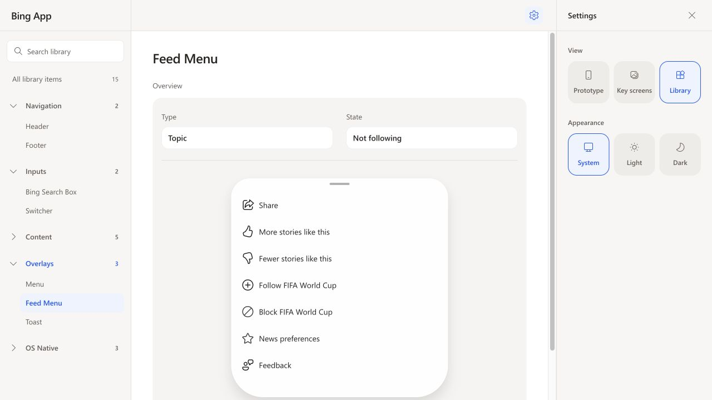

# Library organization

Updated 2026-10-22. All 15 component groups remain available.

| Category order | Component order |
| --- | --- |
| Navigation | Header, Footer |
| Inputs | Bing Search Box, Switcher |
| Content | Avatar, List, Glance Card, Feed Card, Tabs Card |
| Overlays | Menu, Feed Menu, Toast |
| OS Native | iOS Status Bar, iOS Keyboard, iOS Home Indicator |

Toast and both menu types now share Overlays. Browser tab thumbnails are named
Tabs Card and grouped with content. Basics, Sheet and the unused Styles/Page
categories were removed from the catalog type. App Footer and IAB Footer remain
variants within Footer. Only categories and All library items have counts.

Validation:

- `npm test -- src/components/PreviewWorkbench/PreviewWorkbench.test.tsx src/components/PreviewWorkbench/PreviewLibraryGroup.test.tsx`: 19 tests passed.
- `npm run build`: passed (existing bundle-size warning).
- Browser: sidebar and full gallery follow the same order; Overlays opens Menu,
  Feed Menu and Toast. Searching `bottom sheet` finds Feed Menu under Overlays;
  `tabs card` finds all three Tabs Card previews under Content. Clearing search,
  collapsing groups and opening a component work normally.
- This change updates catalog metadata and ordering; preview controls and
  prototype interactions are unchanged.

