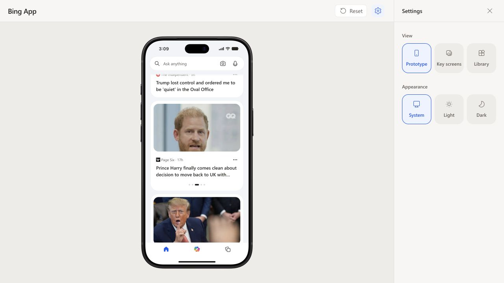

# MSN feed verification — 2026-10-21

- Local `/api/msn-feed` returned HTTP 200 and 12 genuine MSN articles.
- Browser verified the existing single-card and five-slide carousel layouts,
  publisher metadata, real publication dates and focal-position portrait crops.
- System appearance restored after checking both appearances.
- Full suite passed: 35 files, 210 tests. After the focal-position refinement,
  the four affected test files passed all 30 tests, including the added crop test.
- Final `npm run build` and `git diff --check` passed.

