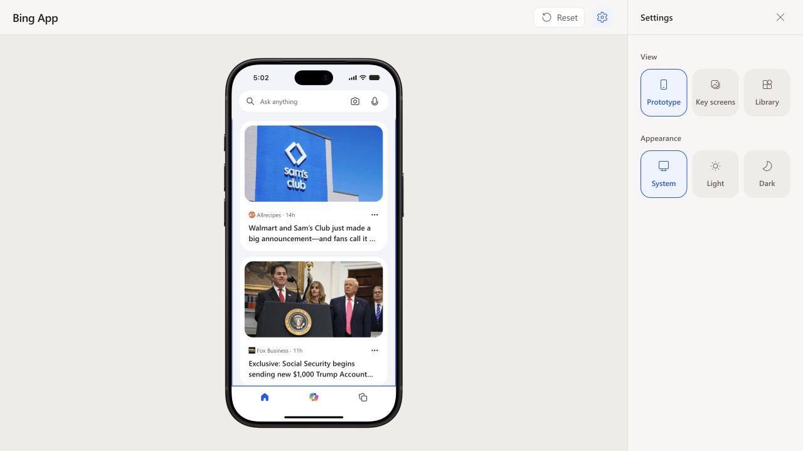
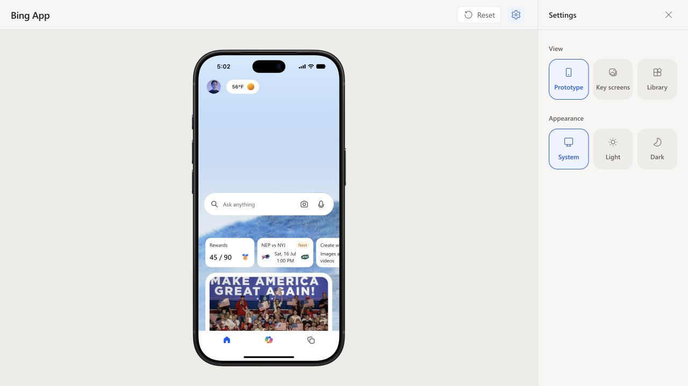

# Feed pagination and Home return — 2026-10-21

- Live local API: four consecutive MSN pages returned 38, 4, 34 and 31 articles,
  contributing 38, 4, 18 and 10 unique IDs respectively (70 unique stories).
- Browser: scrolling to the first and second page boundaries automatically
  appended new cards. Tapping Home returned the same preview to the hero, with
  wallpaper, profile/weather, search and glance cards in their starting positions.
- Regression coverage: page cursors/cache, restricted upstream URLs, empty and
  repeated pages, deduplication, one request at a time, inactive screens, retries,
  expired cursors, cancellation, Home motion synchronization and reduced motion.
- `npm test`: 35 files / 224 tests passed. `npm run build` and
  `git diff --check` passed.

