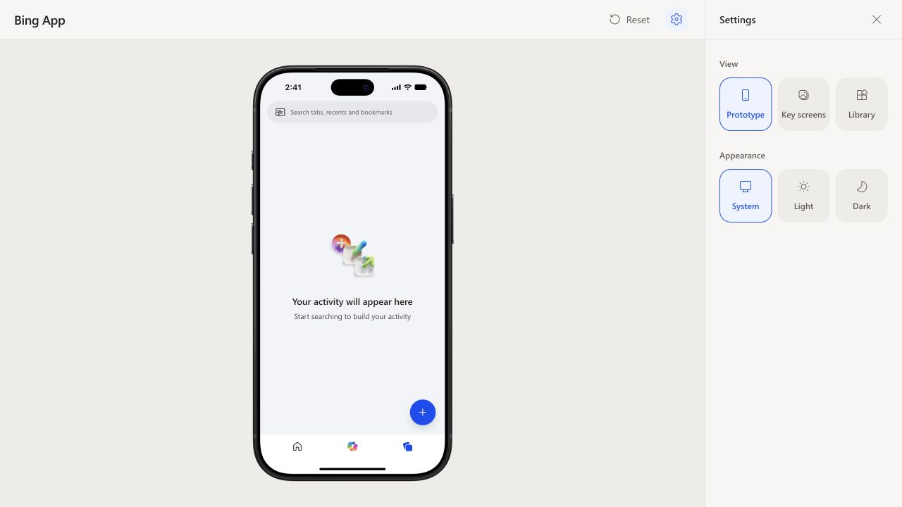

# Prototype activity and reset — 2026-10-21

Prototype starts without Search history, browsing history, tabs, bookmarks or
Copilot conversations. Key screens and Library retain their design fixtures.
Records are local to the mounted prototype session; Reset and reload start empty.

Verified in the local workbench at `http://127.0.0.1:5174/`:

- Recent initially uses the supplied empty illustration; Search has no history section.
- Submitting “Tokyo weather” creates a Recent history visit and tab, and a Search history chip.
- Reset from Search returns to Homepage; Recent and Search then contain no activity.
- The Reset control appears in the upper-right toolbar beside Settings.

Automated coverage also checks blank input, cancellation, query deduplication,
editing versus new-tab submission, private queries, reset from Search/Recent/SERP,
searching again after reset, and preserving appearance and the other workbench views.

Validation: `npm test` — 196 tests passed across 33 files;
`npm run build` and `git diff --check` passed. Existing Vite chunk-size and JSDOM
scrollTo warnings remain non-blocking.

