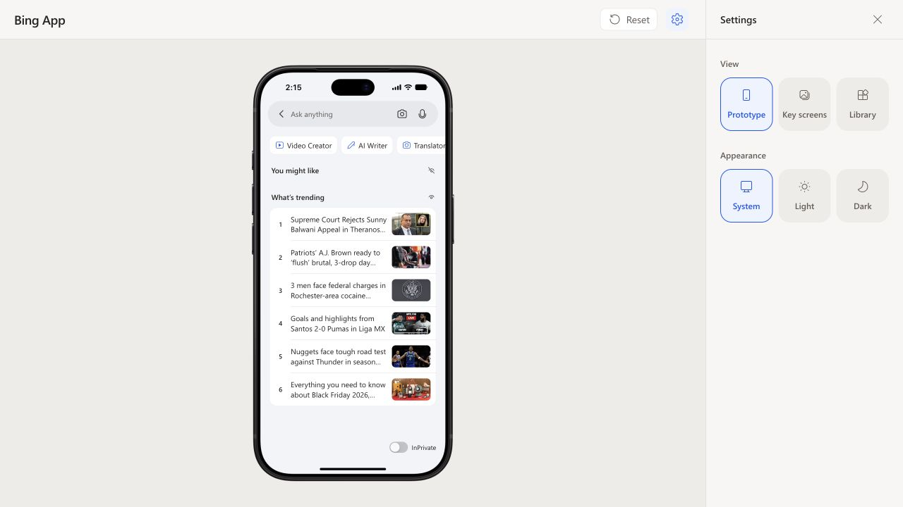

# Search discovery motion refinement

Updated 2026-10-22. Scope: the You might like and What’s trending eye controls.
Native analogy, sources and tuned parameters are documented in
[motion.md](../../motion.md#search-discovery-disclosure).

- Critical spring changes the viewport height; separate fades reveal/hide the
  contents and crossfade the eye symbol. Text and images are never scaled.
- Full content stays mounted and measured, including while collapsed. Rapid
  reversal targets the current animated value instead of restoring `auto`.
- Existing focus, keyboard, accessibility and independent visibility behavior
  remain intact. Reduced motion and passive previews are instant.

Validation:

- `npm run build`: passed (existing bundle-size warning).
- `npm test -- src/screens/Search/Search.discovery.test.tsx src/screens/Search/Search.test.tsx src/screens/BingAppPrototype.test.tsx`: 27 tests passed across 3 files.
- Browser: current 402 × 874 phone at `http://127.0.0.1:5174/`. Measured the
  actual animated DOM geometry through the browser while clicking the eyes.
- YML: outer height went from 168 to 0; inner height stayed 168, with transform
  `none`. The following section header moved with the outer height.
- Trending: outer height went from 432 to 0 and back to 432 monotonically;
  inner height stayed 432, with transform `none`.
- Double-click interrupted YML expansion at approximately 19 px and returned
  continuously to 0, without jumping to the full 168 px height.
- Both section titles stayed visible, and each eye toggled its own section.
  No browser emulation of reduced motion was performed; the instant branch was
  reviewed in code.

Geometry captures use host timestamps; transport latency means these are
continuity checks, not calibrated animation-duration benchmarks:
[YML collapse](./collapse-trace.json),
[rapid reversal](./rapid-reversal-trace.json),
[Trending collapse](./trending-collapse-trace.json),
[Trending expand](./trending-expand-trace.json).

