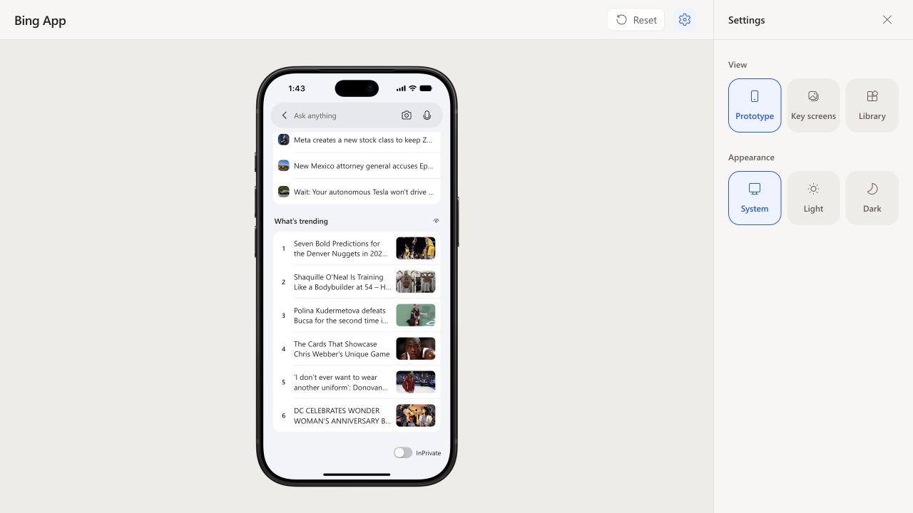

# Search discovery verification — 2026-10-22

- MSN zero-input endpoint returned actual TopStories titles and thumbnail URLs;
  the local route normalized three unique recommendations.
- Google Trends' public US RSS feed returned ten queries with thumbnails on
  2026-10-22. `/api/search-discovery?section=trending` returned six queries and
  six matching Google-supplied image URLs, with `source: google-trends`.
  This replaces Bing QSON, which supplied no thumbnails.
- Browser verified Homepage → Search, prefetched recommendations, thumbnail
  loading, preserved List layout and six numbered live topics displayed with
  readable English headlines and their matching article images. The original
  queries remain in the API data. No added row
  navigation or accidental search-history entries.
- Tests cover source validation, source order, missing/failed
  images, deduplication, independent caching/errors/retries, request cancellation
  and fixture isolation. The revised contract tests also cover RSS decoding,
  CDATA/entities, source order, six-item limit, same-article headline/image pairs,
  malformed/unsafe XML and rejected image/link hosts. Browser and
  live endpoint checks separately verify real data availability.
- `npm test -- server/searchDiscovery.test.ts src/screens/Search/Search.discovery.test.tsx`:
  2 files / 15 tests passed after the headline display change.
- `npm run build` and `git diff --check` passed.

